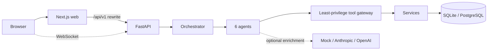

# The Autonomous FinTech Team

**TECHX Tunisia 2026–2027 · IEEE CS ENICarthage x ENIT.** Six specialised AI agents run a complete, secured
customer and financial journey for a fictional AI-training academy: they talk to prospects, understand needs
and objections, run a simulated payment, compute financial KPIs, recommend strategy, and defend every step
against fraud and prompt injection, with humans approving sensitive actions.

> All data is fictional. Payments are simulated. No real card data is ever requested and no real payment can be triggered.

## 1. What it does

| Agent | Role |
|---|---|
| Voice Sales Agent | Chats (text or browser voice), presents offers, handles objections, proposes enrollment |
| Customer Intelligence | Extracts needs, motivations, objections, sentiment, purchase intent, journey stage |
| Payment Agent | Creates checkout sessions with server-side prices, runs the payment state machine |
| Financial Data Analyst | Computes revenue, conversion, payment statuses with exact decimal arithmetic |
| Business Strategy | Recommendations that separate observed facts from hypotheses |
| Security & Fraud | Injection screening, fraud rules, anomaly detection, holds risky payments for humans |

A central **orchestrator** dispatches agents, routes on structured outputs, and records every execution,
agent-to-agent message, state transition and event. See [docs/AGENT_SYSTEM.md](docs/AGENT_SYSTEM.md).

## 2. Architecture



Contract: [ARCHITECTURE.md](ARCHITECTURE.md) · Details: [docs/ARCHITECTURE.md](docs/ARCHITECTURE.md) ·
[Database](docs/DATABASE.md) · [Workflows](docs/WORKFLOWS.md) · [Security](docs/SECURITY.md) · [API](docs/API.md)

## 3. Technology

Backend: Python 3.12, FastAPI, SQLAlchemy 2, Alembic, Pydantic, Argon2, PyJWT, Anthropic + OpenAI SDKs, pytest.
Frontend: Next.js 16 (App Router), React 19, TypeScript strict, Tailwind 4, shadcn/ui, TanStack Query, Recharts,
React Flow, React Hook Form + Zod, Vitest, Playwright. Infra: Docker Compose (PostgreSQL), GitHub Actions.

## 4. Prerequisites

- [uv](https://docs.astral.sh/uv/) (installs Python 3.12 automatically)
- Node.js 22+ and npm
- Optional: Docker Desktop

## 5–10. Install, configure, migrate, seed, run

```bash
cp .env.example .env                 # defaults work as-is (SQLite, mock AI)

# backend
cd apps/api
uv sync
uv run alembic upgrade head          # migrations
uv run python -m app.seed            # fictional demo data (--reset to wipe)
uv run uvicorn app.main:app --reload --port 8000

# frontend (second terminal)
cd apps/web
npm install
npm run dev                          # http://localhost:3000
```

Shortcuts: `make install|seed|reset|dev|test` (macOS/Linux) or `./scripts/dev.ps1 install|seed|reset|dev|test` (Windows).

Environment variables are documented in [.env.example](.env.example). To use a real model set
`AI_PROVIDER=anthropic` and `ANTHROPIC_API_KEY` (or `openai` + `OPENAI_API_KEY`). Keys stay on the server.

### Demo accounts (password `Demo!2026`)

| Email | Role |
|---|---|
| admin@demo.techx | SUPER_ADMIN |
| finance@demo.techx | FINANCE_MANAGER |
| security@demo.techx | SECURITY_ANALYST |
| sales@demo.techx | SALES_MANAGER |
| viewer@demo.techx | VIEWER |

Customers do not log in: the public assistant at `/assistant` creates a fictional customer per conversation.

## 11. API documentation

Swagger UI at http://localhost:8000/docs. Overview in [docs/API.md](docs/API.md).

## 12. Testing

```bash
cd apps/api && uv run pytest -q          # 111 backend tests
cd apps/web && npm test                  # unit tests
cd apps/web && npx playwright test       # E2E (servers running)
```

See [docs/TESTING.md](docs/TESTING.md).

## 13. Demo scenarios

Run them from **Demo control** (`/demo`) or follow the 7-minute script in [docs/DEMO_GUIDE.md](docs/DEMO_GUIDE.md):
successful journey, failed payment, suspicious activity (held for approval), prompt injection, business intelligence.

## 14. Deployment

`docker compose up --build` (PostgreSQL + API + web). See [docs/DEPLOYMENT.md](docs/DEPLOYMENT.md).

## 15. Known limitations

- Payments are simulated only; no sandbox gateway is connected (adapter point: `payments.execute_provider`).
- Real-time bus and login rate limiter are in-process (single API instance); Redis is the upgrade path.
- Voice relies on browser Web Speech APIs (best in Chrome/Edge); text always works.
- The injection classifier is pattern-based; model output never controls state or permissions, which limits the blast radius of a miss.
- Intent, sentiment and confidence are estimates and are labelled as such.
- Docker Compose was written but not executed on the build machine (Docker daemon unavailable); local SQLite flow is verified.
