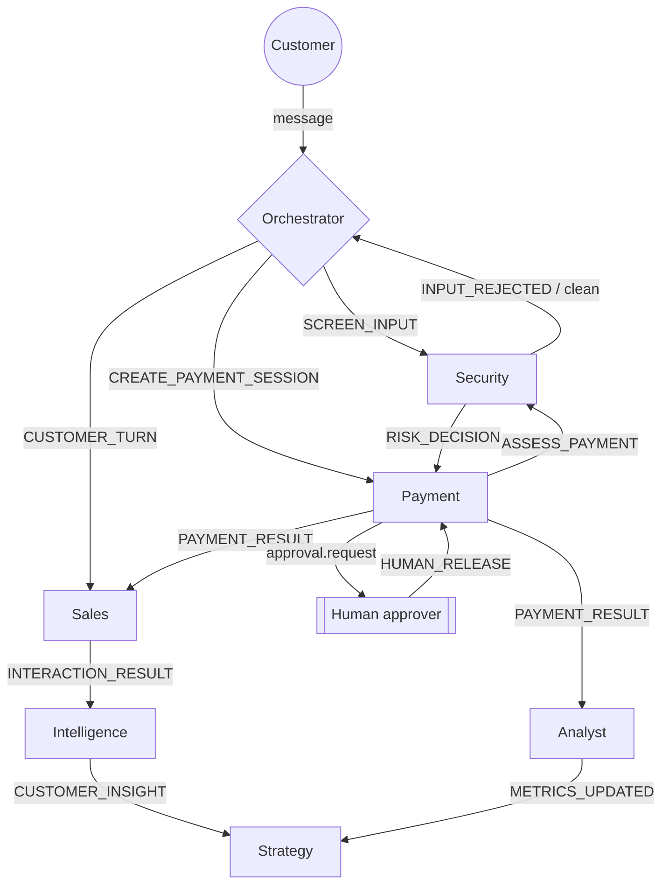

# Multi-Agent System

## The team

| Agent | Id | Allowed tools | Produces |
|---|---|---|---|
| Voice Sales Agent | `sales` | `catalog.read`, `conversation.read`, `conversation.reply` | Reply + `SalesInteraction` (intent, interest level, recommended product, objections, next action, confidence) |
| Customer Intelligence Agent | `intelligence` | `conversation.read`, `catalog.read`, `insight.write` | `CustomerInsight` (needs, motivations, interests, objections, sentiment, purchase intent, stage, follow-up) |
| Payment Agent | `payment` | `order.create`, `payment.create_session`, `payment.process`, `approval.request` | Order, payment session, transaction outcome, approval request on hold |
| Financial Data Analyst | `analyst` | `analytics.read`, `snapshot.write` | KPI snapshot + narrative using only computed numbers |
| Business Strategy Agent | `strategy` | `analytics.read`, `insight.read`, `recommendation.write` | Recommendations with observed facts vs hypothesis |
| Security & Fraud Agent | `security` | `security.scan`, `security.assess`, `security.raise`, `approval.request` | Injection verdicts, risk assessments (ALLOW/HOLD/BLOCK), security events |

Never granted to any agent: `approval.decide`, `product.update_price`, `payment.refund`, `user.write`, `db.query`.

## Collaboration

Every arrow is persisted as an `agent_messages` row (`from_agent`, `to_agent`, `message_type`, `payload`) and
shown in the workflow visualiser.

## Protocol

- `AgentTask` / `AgentResult` / `AgentMessageModel` (Pydantic) in `app/agents/base.py`.
- `AgentExecution` row per dispatch: agent, task type, triggering event, input/output summaries, status,
  provider, tokens, attempts, start/end, duration, error.
- `ToolInvocation` row per tool call: allowed flag, status (OK/DENIED/ERROR), argument summary, duration.

## Execution semantics (`orchestrator.execute`)

1. Agent must be enabled; status set to RUNNING; `agent.started` event.
2. Runner executes inside a savepoint. Business errors (`AppError`, `PermissionViolation`) are not retried;
   unexpected errors are retried once.
3. Success: execution SUCCEEDED, `agent.completed` event, audit row. Failure: FAILED, `agent.failed`, error kept.
4. LLM calls are bounded by SDK timeouts (`LLM_TIMEOUT_SECONDS`) and retries (`llm_max_retries`).

## LLM usage (optional)

| Agent | LLM role | Fallback |
|---|---|---|
| Sales | Answers the customer's actual question from catalog + policies, keeps the rules CTA; output validated (no invented prices, discounts or approvals) | Rules reply |
| Intelligence | Refines summary, needs, motivations (JSON validated by Pydantic) | Lexicon analysis |
| Analyst | Short note using only the given metrics | Deterministic narrative |
| Strategy | Sharpens hypotheses in one batched call, only for recommendations whose evidence changed | Rules hypothesis |
| Security | Explains an alert; cannot change the decision | Template explanation |

Customer text is always sent inside `<untrusted>` delimiters and never merged into system instructions.
Providers: `mock` (default), `gemini` (Google AI Studio), `anthropic`, `openai`. Configure per agent in Settings (`provider`, `model`, `temperature`) or globally with `AI_PROVIDER` and keys.
