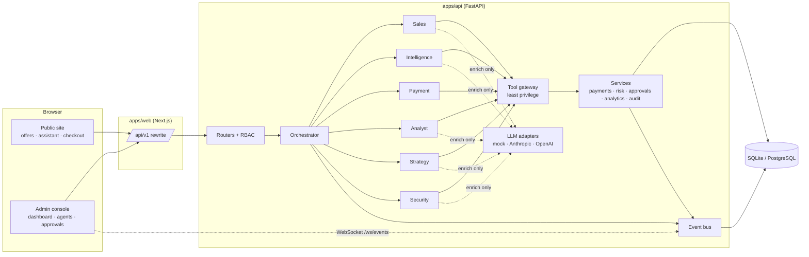

# System Architecture

The REST/WS contract lives in the root [ARCHITECTURE.md](../ARCHITECTURE.md). This page explains how the parts fit.

## Overview

## Layers

| Layer | Location | Responsibility |
|---|---|---|
| Routers | `app/api/v1/*` | HTTP validation (Pydantic), RBAC via `require(perm)`, transactions (commit) |
| Orchestrator | `app/orchestration/orchestrator.py` | The only dispatcher of agents; workflow state machine; agent messages; retries |
| Agents | `app/agents/*` | Specialised logic; act only through `ctx.use(tool, fn)` |
| Tool gateway | `app/agents/base.py::invoke` | Allowlist check, tool-invocation log, audit, security event on violation |
| Services | `app/services/*` | Business rules: payment state machine, risk engine, approvals, analytics, audit, events |
| LLM adapters | `app/llm/providers.py` | Provider-agnostic `complete`/`complete_json`; any failure -> deterministic fallback |
| Models | `app/models/__init__.py` | SQLAlchemy 2 ORM, UUID keys, exact Money, tz-aware UTC timestamps |

## Technical decisions

- **Deterministic core, LLM enrichment.** The demo must work offline and judges must trust the numbers.
  Financial figures, security decisions and workflow transitions never depend on model text.
- **Synchronous SQLAlchemy** in FastAPI's threadpool: simpler transactions; LLM latency is bounded by SDK timeouts.
- **Events after commit.** `events.publish` writes a `system_events` row; broadcast happens in the session's
  `after_commit` hook, so clients never see rolled-back events. Clients catch up with `GET /events?after_id=`.
- **Money** stored as integer millimes (TND has 1000 subunits) via a `Money` TypeDecorator.
- **Seed through services**: demo data is generated by driving the orchestrator, then time-shifted.

## Limitations and future work

- Single API instance (in-process event bus). Add Redis pub/sub for horizontal scaling.
- Rate limiter is in-memory. Move to Redis.
- Voice uses browser Web Speech APIs; a server STT/TTS adapter (e.g. Whisper, a TTS API) can be added behind the same UI.
- Payment provider is simulated only by design; a sandbox adapter (e.g. Stripe test mode) would plug into
  `payments.execute_provider`.
- Revenue forecasting (ML) is not implemented.
