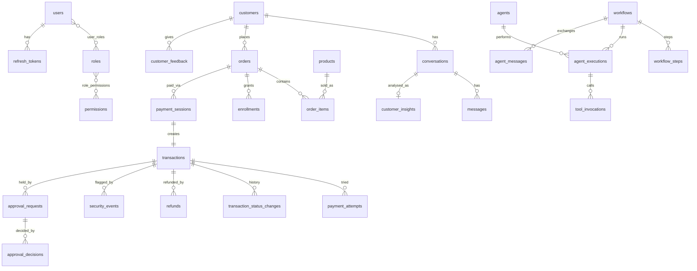

# Database

SQLAlchemy 2 models in `apps/api/app/models/__init__.py`; migrations in `apps/api/migrations` (Alembic,
`render_as_batch` for SQLite). Default engine SQLite (`fintech.db`), PostgreSQL 16 in Docker.

Conventions: UUID primary keys (audit logs and system events use autoincrement integers for ordering),
UTC tz-aware timestamps (`UTCDateTime`), money as integer millimes (`Money` -> `Decimal`), enums stored as
strings, explicit `ondelete` policies.



## Tables

| Group | Tables |
|---|---|
| Access | `users`, `roles`, `permissions`, `user_roles`, `role_permissions`, `refresh_tokens`, `password_reset_tokens` |
| Sales | `customers`, `products` (offers), `conversations`, `messages`, `customer_insights`, `orders`, `order_items`, `enrollments`, `customer_feedback` |
| Financial | `payment_sessions`, `transactions`, `transaction_status_changes`, `payment_attempts`, `refunds` |
| AI | `agents`, `agent_executions` (also serves as agent task log), `agent_messages`, `workflows`, `workflow_steps`, `tool_invocations` |
| Governance | `security_events` (fraud alerts = category FRAUD), `approval_requests`, `approval_decisions`, `audit_logs` |
| Analytics | `business_recommendations`, `analytics_snapshots`, `system_events` |

## Integrity rules

- `payment_sessions.idempotency_key` and `payment_attempts.idempotency_key` are unique.
- One transaction per payment session; one insight per conversation; one workflow per conversation.
- `audit_logs`: no update/delete code path; PostgreSQL trigger `audit_logs_no_mutation` rejects UPDATE/DELETE;
  each row stores `prev_hash` and `hash` (SHA-256 chain), verifiable via `GET /api/v1/audit/verify`.
- Messages flagged as injection keep `flagged=true` and are excluded from model context.

## Commands

```bash
cd apps/api
uv run alembic upgrade head          # create / migrate schema
uv run python -m app.seed            # seed fictional data (if empty)
uv run python -m app.seed --reset    # wipe and reseed
uv run alembic revision --autogenerate -m "change"   # after editing models
```
