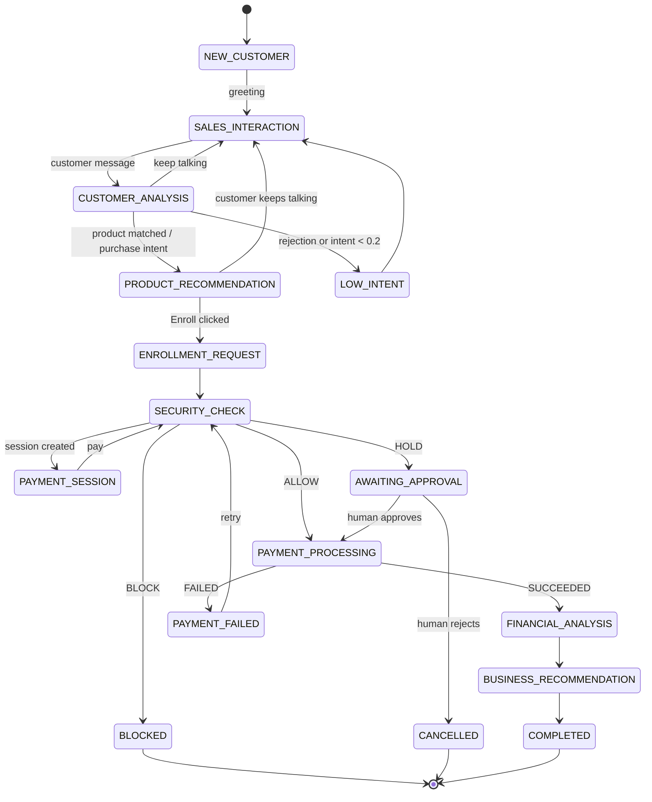
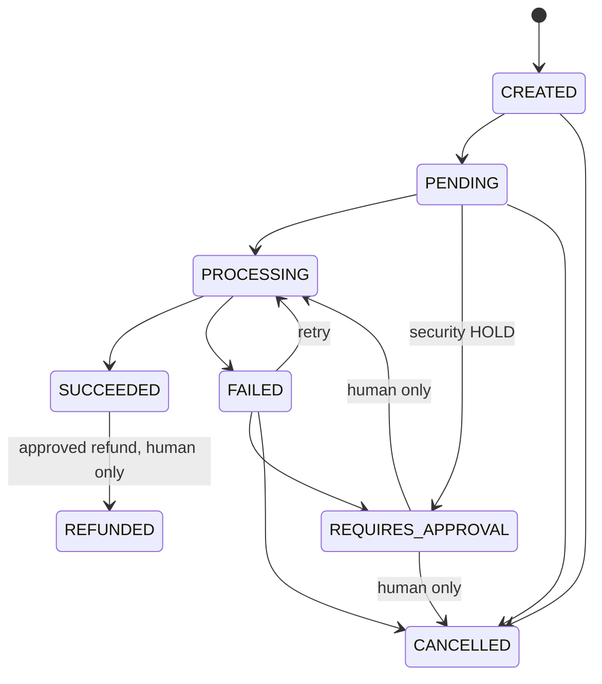
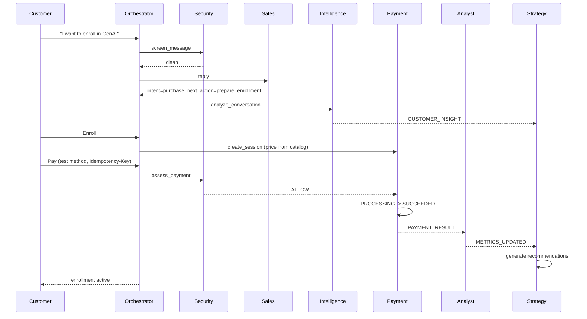

# Workflows

## Customer journey state machine

Transitions are validated by `ALLOWED_STATES` in the orchestrator and recorded as `workflow_steps`
(`from_state`, `to_state`, agent, note). Routing uses structured fields only (`next_action`, `intent`,
`purchase_intent`, risk `decision`), never free text. `ERROR` and `CANCELLED` are reachable from any state.

## Transaction state machine

Every change writes `transaction_status_changes` (actor, reason), an audit row and a `payment.updated` event.

## Approval lifecycle

`PENDING_REVIEW -> APPROVED | REJECTED | EXPIRED`, with `INFO_REQUESTED` as a reversible intermediate.
Expiry is applied lazily (`approvals.expire_stale`) when the approval list is read.

## Sequence: successful purchase

